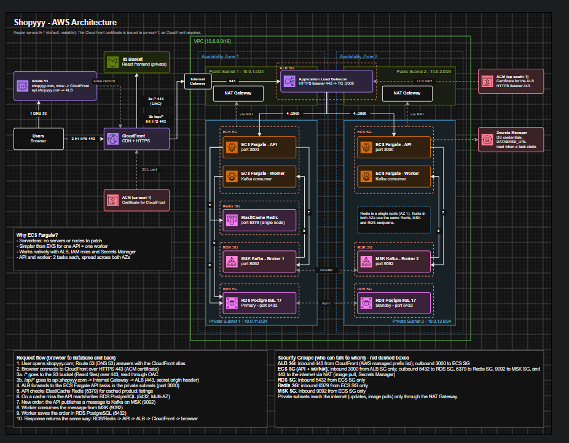

# AWS E-Commerce Infrastructure with Terraform

A portfolio project demonstrating how to design and provision a production-style e-commerce backend architecture on AWS using Terraform.

> **Note:** This repository is a portfolio version of an AWS DevOps infrastructure project. It does not contain the original assessment document, recruiter communication, credentials, Terraform state, or other private material.

## Architecture

The platform uses:

- **Route 53** for DNS
- **ACM** for TLS certificates
- **CloudFront** as the public entry point and CDN
- **S3** for React/static frontend files
- **Application Load Balancer** for API traffic
- **ECS Fargate** for API and worker containers
- **RDS PostgreSQL** for application data with Multi-AZ
- **ElastiCache Redis** for caching
- **Amazon MSK (Kafka)** for asynchronous order processing
- **Secrets Manager** for database credentials
- **CloudWatch Logs** for ECS logs
- **VPC, NAT Gateway, route tables and Security Groups** for networking and isolation



The editable draw.io diagram is also included in `architecture/aws-ecommerce-architecture.drawio`.

## Request and data flow

1. A user accesses the application through Route 53.
2. Route 53 points the domain to CloudFront.
3. CloudFront serves frontend assets from the private S3 bucket using Origin Access Control.
4. `/api/*` requests are forwarded to the Application Load Balancer.
5. The ALB forwards API traffic to ECS Fargate tasks in private subnets.
6. The API uses Redis for caching and RDS PostgreSQL for persistent data.
7. Order events are published to MSK/Kafka.
8. A worker service consumes Kafka messages and performs background order processing.
9. Private workloads use NAT Gateway for required outbound internet access.

## Why ECS Fargate?

Fargate was selected to run the API and worker containers without managing EC2 instances. It keeps the compute layer relatively simple while supporting multiple tasks across Availability Zones.

## Security approach

- Internet-facing traffic terminates at CloudFront/ALB.
- ECS tasks run in private subnets.
- RDS, Redis and MSK are private and are not directly exposed to the internet.
- Security Groups restrict traffic between layers.
- RDS accepts PostgreSQL traffic only from the ECS Security Group.
- Redis accepts Redis traffic only from the ECS Security Group.
- MSK accepts Kafka traffic only from the ECS Security Group.
- Database credentials are generated and stored in AWS Secrets Manager.
- The S3 frontend bucket blocks public access and is accessed through CloudFront OAC.

## Terraform structure

```text
.
├── architecture/
│   ├── aws-ecommerce-architecture.drawio
│   └── aws-ecommerce-architecture.png
├── terraform/
│   ├── alb.tf
│   ├── cloudfront.tf
│   ├── dns_acm.tf
│   ├── ecs.tf
│   ├── elasticache.tf
│   ├── locals.tf
│   ├── msk.tf
│   ├── networking.tf
│   ├── outputs.tf
│   ├── providers.tf
│   ├── rds.tf
│   ├── s3.tf
│   ├── security_groups.tf
│   ├── variables.tf
│   ├── versions.tf
│   ├── backend.hcl.example
│   └── terraform.tfvars.example
├── .gitignore
└── README.md
```

## Running the project

> The Terraform configuration creates AWS resources that can incur charges. Review the configuration and your AWS costs before applying it.

1. Configure AWS credentials using your normal AWS CLI/profile setup.
2. Copy the example configuration files:

```bash
cd terraform
cp backend.hcl.example backend.hcl
cp terraform.tfvars.example terraform.tfvars
```

3. Set your own domain, AWS region, CIDRs and other values in `terraform.tfvars` and `backend.hcl`.
4. Initialize Terraform:

```bash
terraform init -backend-config=backend.hcl
```

5. Review the plan:

```bash
terraform plan
```

6. Apply when you are ready:

```bash
terraform apply
```

For a real deployment, use a domain you control and configure the Route 53 delegation/DNS validation required by ACM.

## Important development notes

The default ECS image is a placeholder (`hashicorp/http-echo`) so the infrastructure can demonstrate the container path without a private application image. Replace it with your own application image for a real deployment.

Some settings are intentionally development-oriented, such as skipping the final RDS snapshot and disabling deletion protection. Review these before using the configuration for production.

## What this project demonstrates

- AWS networking and subnet design
- Infrastructure as Code with Terraform
- ECS/Fargate container deployment
- Load balancing and CloudFront routing
- RDS Multi-AZ database design
- Redis caching
- Kafka-based asynchronous processing
- Security Group based network controls
- Secrets Manager integration
- Terraform remote state
- High-availability design across two Availability Zones
